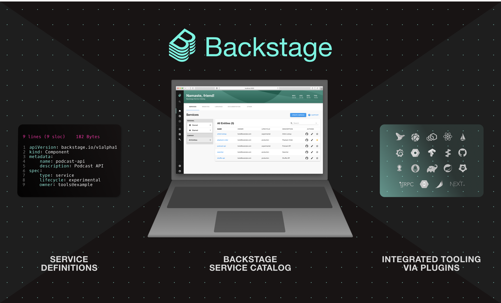
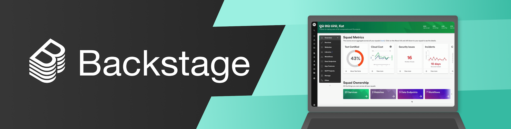

<!-- vale off -->

˙[ssǝɔoɹd ǝsɐǝlǝɹ ʎʇᴉɹnɔǝs](SECURITY.md) ǝʇǝldɯoɔ ɹno ǝǝs ʻslᴉɐʇǝp ɹǝɥʇɹnɟ ɹoℲ

˙qnHʇᴉ⅁ uɐɥʇ ɹǝɥʇɐɹ [ɯɐɹƃoɹd ʎʇunoq-ƃnq](https://hackerone.com/spotify) s‘ʎɟᴉʇodS ƃuᴉsn sǝnssᴉ ʎʇᴉɹnɔǝs ǝʌᴉʇᴉsuǝs ʇɹodǝɹ ǝsɐǝlԀ

## ʎʇᴉɹnɔǝS

[0˙2-ƎSNƎƆI˥/sǝsuǝɔᴉl/ƃɹo˙ǝɥɔɐdɐ˙ʍʍʍ//:dʇʇɥ](http://www.apache.org/licenses/LICENSE-2.0) :0˙2 uoᴉsɹǝΛ ʻǝsuǝɔᴉ˥ ǝɥɔɐd∀ ǝɥʇ ɹǝpun pǝsuǝɔᴉ˥

[ǝƃɐsn-ʞɹɐɯǝpɐɹʇ/ƃɹo˙uoᴉʇɐpunoɟxnuᴉl˙ʍʍʍ//:sdʇʇɥ](https://www.linuxfoundation.org/trademark-usage) :ǝƃɐd ǝƃɐs∩ ʞɹɐɯǝpɐɹ⊥ ɹno ǝǝs ǝsɐǝld ʻuoᴉʇɐpunoℲ xnuᴉ˥ ǝɥ⊥ ɟo sʞɹɐɯǝpɐɹʇ ɟo ʇsᴉl ɐ ɹoℲ ˙sʞɹɐɯǝpɐɹʇ sǝsn puɐ sʞɹɐɯǝpɐɹʇ pǝɹǝʇsᴉƃǝɹ sɐɥ uoᴉʇɐpunoℲ xnuᴉ˥ ǝɥ⊥ ˙pǝʌɹǝsǝɹ sʇɥƃᴉɹ ll∀ ˙sɹoɥʇn∀ ǝƃɐʇsʞɔɐ𐐒 ǝɥ⊥ © 9202-0202 ʇɥƃᴉɹʎdoƆ

## ǝsuǝɔᴉ˥

˙ʎɹoʇᴉsodǝɹ [ʎʇᴉunɯɯoɔ/ǝƃɐʇsʞɔɐq](https://github.com/backstage/community) ǝɥʇ uᴉ ʇuǝɯnɔop [pɯ˙ƎƆN∀NᴚƎΛO⅁](https://github.com/backstage/community/blob/main/GOVERNANCE.md) ǝɥʇ ǝǝS

## ǝɔuɐuɹǝʌo⅁

- ❤️ ɹɐʇs ɐ ǝʌol plnoʍ ǝʍ ʻʇɔǝɾoɹd ƃuᴉʇsǝɹǝʇuᴉ uɐ sᴉ ʇᴉ ʞuᴉɥʇ ɹo ǝƃɐʇsʞɔɐ𐐒 ƃuᴉsn ǝɹɐ noʎ ɟI - ⭐️ ɹɐʇs ɐ sn ǝʌᴉ⅁
- ʎʇᴉunɯɯoɔ ǝƃɐʇsʞɔɐ𐐒 ǝɹoldxǝ puɐ sdnʇǝǝɯ ʎlɥʇuoɯ uᴉoſ - [suoᴉssǝS ʎʇᴉunɯɯoƆ ǝƃɐʇsʞɔɐ𐐒](https://github.com/backstage/community)
- ɹǝʇʇǝlsʍǝu lᴉɐɯǝ ɹno oʇ ǝqᴉɹɔsqnS - [ɹǝʇʇǝlsʍǝN](https://spoti.fi/backstagenewsletter)
- sǝʇɐpdn puɐ sʇuǝɯǝɔunouu∀ - [ƃol𐐒](https://backstage.io/blog/)
- ǝƃɐʇsʞɔɐ𐐒 ƃuᴉsn ʎpɐǝɹlɐ sǝᴉuɐdɯoƆ - [sɹǝʇdop∀](ADOPTERS.md)
- lloɹ ǝʍ ʍoɥ sᴉ sᴉɥ⊥ - [ʇɔnpuoƆ ɟo ǝpoƆ](CODE_OF_CONDUCT.md)
- suoᴉʇsǝnΌ pǝʞs∀ ʎlʇuǝnbǝɹℲ - [Ό∀Ⅎ](https://backstage.io/docs/faq)
- uoᴉʇɔǝɹᴉp lɐɔᴉuɥɔǝʇ ǝɥʇ ǝdɐɥs dlǝH - [sƆℲᴚ](https://github.com/backstage/backstage/labels/rfc)
- ǝʇnqᴉɹʇuoɔ oʇ ʇuɐʍ noʎ ɟᴉ ǝɹǝɥ ʇɹɐʇS - [ǝƃɐʇsʞɔɐ𐐒 oʇ ƃuᴉʇnqᴉɹʇuoƆ](https://github.com/backstage/backstage/blob/master/CONTRIBUTING.md)
- ʇɔǝɾoɹd ǝɥʇ ssnɔsᴉp ɹo ʇɹoddns ʇǝ⅁ - [ɯooɹʇɐɥɔ pɹoɔsᴉᗡ](https://discord.gg/backstage-687207715902193673)

:sǝɔɹnosǝɹ ƃuᴉʍolloɟ ǝɥʇ ǝsn uɐɔ noʎ ʻʎʇᴉunɯɯoɔ ɹno ɥʇᴉʍ ǝƃɐƃuǝ o⊥

## ʎʇᴉunɯɯoƆ

- [sʇuǝuodɯoɔ I∩ - ʞooqʎɹoʇS](https://backstage.io/storybook)
- [ǝƃɐʇsʞɔɐ𐐒 ɹoɟ ƃuᴉuƃᴉsǝᗡ](https://backstage.io/docs/dls/design)
- ([suoᴉsᴉɔǝᗡ](https://backstage.io/docs/architecture-decisions/)) [ǝɹnʇɔǝʇᴉɥɔɹ∀](https://backstage.io/docs/overview/architecture-overview)
- [ƃolɐʇɐƆ ǝɹɐʍʇɟoS](https://backstage.io/docs/features/software-catalog/)
- [uoᴉʇɐʇuǝɯnɔop uᴉɐW](https://backstage.io/docs)

:sǝpnlɔuᴉ ǝƃɐʇsʞɔɐ𐐒 ɟo uoᴉʇɐʇuǝɯnɔop ǝɥ⊥

## uoᴉʇɐʇuǝɯnɔoᗡ

˙[uoᴉʇɐʇuǝɯnɔop pǝʇɹɐʇS ƃuᴉʇʇǝ⅁](https://backstage.io/docs/getting-started) ǝɥʇ ǝǝs ʻǝƃɐʇsʞɔɐ𐐒 ƃuᴉsn ʇɹɐʇs o⊥

## pǝʇɹɐʇS ƃuᴉʇʇǝ⅁

˙[dɐɯpɐoᴚ ǝɥʇ](https://backstage.io/docs/overview/roadmap) ǝǝs ʻsǝuoʇsǝlᴉɯ pǝɹǝʌᴉlǝp ƃuᴉpnlɔuᴉ dɐɯpɐoɹ ʇɔǝɾoɹd pǝlᴉɐʇǝp ǝɥʇ ʇnoqɐ uoᴉʇɐɯɹoɟuᴉ ɹoℲ

## dɐɯpɐoɹ ʇɔǝɾoɹԀ

˙[ʇuǝɯǝɔunouuɐ](https://backstage.io/blog/2022/03/16/backstage-turns-two#out-of-the-sandbox-and-into-incubation) ǝɥʇ ǝǝs ʻuoᴉʇɐɯɹoɟuᴉ ǝɹoɯ ɹoℲ ˙ʇɔǝɾoɹd lǝʌǝl uoᴉʇɐqnɔuI uɐ sɐ [(ℲƆNƆ) uoᴉʇɐpunoℲ ƃuᴉʇndɯoƆ ǝʌᴉʇɐN pnolƆ](https://www.cncf.io) ǝɥʇ ʎq pǝʇsoɥ ʍou sᴉ ʇnq ʎɟᴉʇodS ʎq pǝʇɐǝɹɔ sɐʍ ǝƃɐʇsʞɔɐ𐐒

- ʎʇᴉlɐuoᴉʇɔunɟ puɐ ʎʇᴉlᴉqɐzᴉɯoʇsnɔ s‘ǝƃɐʇsʞɔɐ𐐒 puɐdxǝ ɹǝɥʇɹnɟ ʇɐɥʇ [suᴉƃnld ǝɔɹnos uǝdo](https://github.com/backstage/backstage/tree/master/plugins) ɟo ɯǝʇsʎsoɔǝ ƃuᴉʍoɹƃ ɐ ʻsnlԀ
- ɥɔɐoɹddɐ "ǝpoɔ ǝʞᴉl sɔop" ɐ ƃuᴉsn ʻuoᴉʇɐʇuǝɯnɔop lɐɔᴉuɥɔǝʇ ǝsn puɐ ʻpuᴉɟ ʻuᴉɐʇuᴉɐɯ ʻǝʇɐǝɹɔ oʇ ʎsɐǝ ʇᴉ ƃuᴉʞɐɯ ɹoɟ [sɔoᗡɥɔǝ⊥ ǝƃɐʇsʞɔɐ𐐒](https://backstage.io/docs/features/techdocs/)
- sǝɔᴉʇɔɐɹd ʇsǝq s‘uoᴉʇɐzᴉuɐƃɹo ɹnoʎ ɥʇᴉʍ ƃuᴉlooʇ ɹnoʎ ƃuᴉzᴉpɹɐpuɐʇs puɐ sʇɔǝɾoɹd ʍǝu dn ƃuᴉuuᴉds ʎlʞɔᴉnb ɹoɟ [sǝʇɐldɯǝ⊥ ǝɹɐʍʇɟoS ǝƃɐʇsʞɔɐ𐐒](https://backstage.io/docs/features/software-templates/)
- slǝpoɯ ˥W puɐ ʻsǝʇᴉsqǝʍ ʻsǝuᴉlǝdᴉd ɐʇɐp ʻsǝᴉɹɐɹqᴉl ʻsǝɔᴉʌɹǝsoɹɔᴉɯ sɐ ɥɔns ǝɹɐʍʇɟos ɹnoʎ llɐ ƃuᴉƃɐuɐɯ ɹoɟ [ƃolɐʇɐƆ ǝɹɐʍʇɟoS ǝƃɐʇsʞɔɐ𐐒](https://backstage.io/docs/features/software-catalog/)

:sǝpnlɔuᴉ ǝƃɐʇsʞɔɐ𐐒 ʻxoq ǝɥʇ ɟo ʇnO

˙puǝ oʇ puǝ ɯoɹɟ ʇuǝɯuoɹᴉʌuǝ ʇuǝɯdolǝʌǝp pǝuᴉlɯɐǝɹʇs ɐ ǝʇɐǝɹɔ oʇ uoᴉʇɐʇuǝɯnɔop puɐ ʻsǝɔᴉʌɹǝs ʻƃuᴉlooʇ ǝɹnʇɔnɹʇsɐɹɟuᴉ ɹnoʎ llɐ sǝᴉɟᴉun ǝƃɐʇsʞɔɐ𐐒

˙ʎɯouoʇnɐ ƃuᴉsᴉɯoɹdɯoɔ ʇnoɥʇᴉʍ ʎlʞɔᴉnb ǝpoɔ ʎʇᴉlɐnb-ɥƃᴉɥ dᴉɥs oʇ sɯɐǝʇ ʇɔnpoɹd ɹnoʎ sǝlqɐuǝ puɐ ǝɹnʇɔnɹʇsɐɹɟuᴉ puɐ sǝɔᴉʌɹǝsoɹɔᴉɯ ɹnoʎ oʇ ɹǝpɹo sǝɹoʇsǝɹ ǝƃɐʇsʞɔɐ𐐒 ʻƃolɐʇɐɔ ǝɹɐʍʇɟos pǝzᴉlɐɹʇuǝɔ ɐ ʎq pǝɹǝʍoԀ ˙slɐʇɹod ɹǝdolǝʌǝp ƃuᴉplᴉnq ɹoɟ ʞɹoʍǝɯɐɹɟ ǝɔɹnos uǝdo uɐ sᴉ [ǝƃɐʇsʞɔɐ𐐒](https://backstage.io/)

## ¿ǝƃɐʇsʞɔɐ𐐒 sᴉ ʇɐɥM

> ˙ʇsnƃn∀ ɟo ƃuᴉuuᴉƃǝq ǝɥʇ lᴉʇun ʍols ʇᴉq ɐ uᴉɐɯǝɹ ʎɐɯ sƃuᴉɥʇ ʇnq ʻsʎɐpᴉloɥ ɹǝɯɯns ǝɥʇ ɹǝʇɟɐ ǝɯnsǝɹ llᴉʍ ǝɔᴉʌɹǝs lɐɯɹoN ˙poᴉɹǝd ʎɐpᴉloɥ ɹǝɯɯns ǝɥʇ ƃuᴉɹnp lɐnsn uɐɥʇ ɹǝʍols ǝq ʎɐɯ sʍǝᴉʌǝɹ puɐ sǝsuodsǝɹ ɹǝuᴉɐʇuᴉɐW **:ǝɔᴉʇou ʎɐpᴉloɥ ɹǝɯɯnS** ☀️

[語本日](README-ja_JP.md) \| [sᴉɐɔ̧uɐɹℲ](README-fr_FR.md) \| [版文中](README-zh_Hans.md) \| [어국한](README-ko_kr.md) \| ɥsᴉlƃuƎ

# [ǝƃɐʇsʞɔɐ𐐒](https://backstage.io)

<!-- vale on -->
