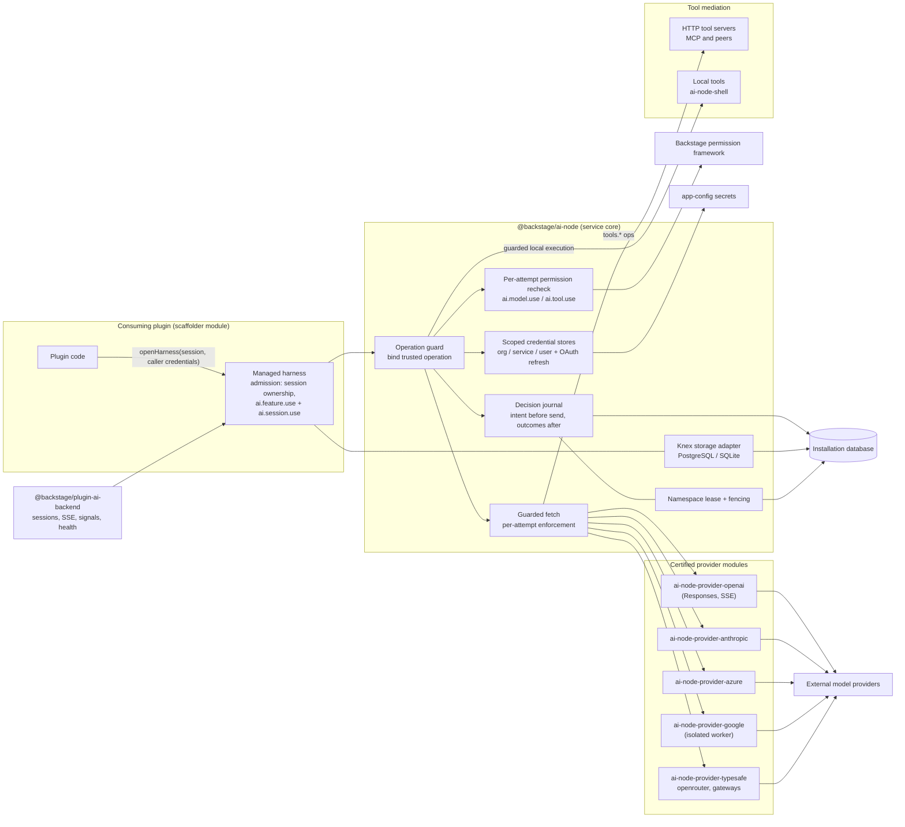
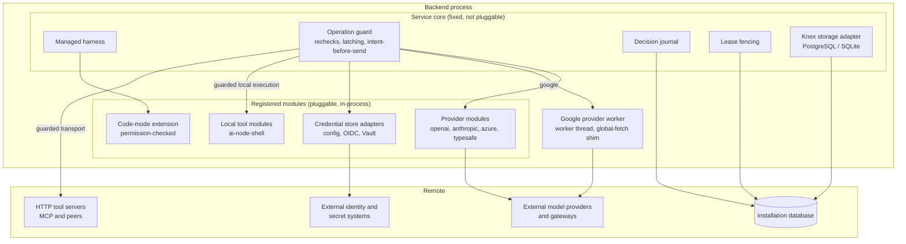
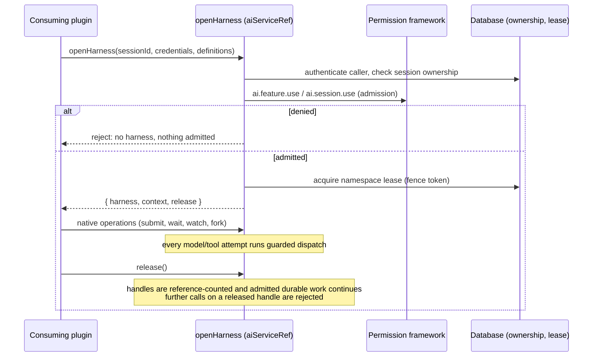
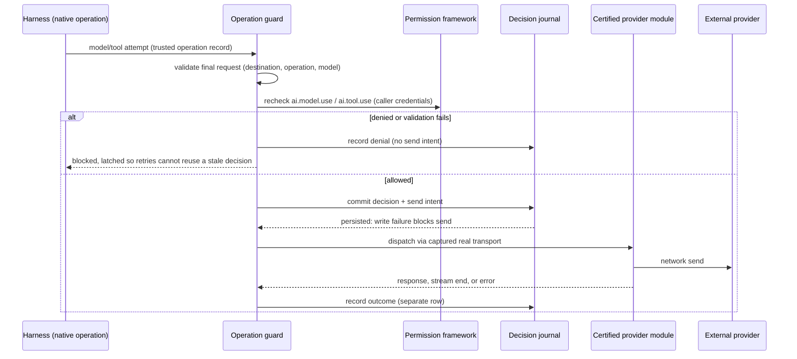
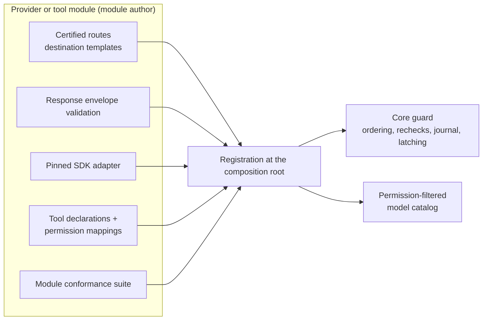

# BEP: Managed AI Service

- [Summary](#summary)
- [Motivation](#motivation)
  - [Goals](#goals)
  - [Non-Goals](#non-goals)
- [Proposal](#proposal)
  - [The managed harness](#the-managed-harness)
  - [Guarded dispatch](#guarded-dispatch)
  - [Separation of responsibilities](#separation-of-responsibilities)
  - [System overview](#system-overview)
  - [Extension points and deployment boundaries](#extension-points-and-deployment-boundaries)
  - [Package layout](#package-layout)
- [API Design](#api-design)
  - [Harness lifecycle](#harness-lifecycle)
  - [Dispatch of a single attempt](#dispatch-of-a-single-attempt)
  - [Module registration](#module-registration)
- [Design Details](#design-details)
  - [Permissions and access control](#permissions-and-access-control)
  - [The decision journal](#the-decision-journal)
  - [Credentials and gateways](#credentials-and-gateways)
  - [Certified provider modules](#certified-provider-modules)
  - [Tool mediation](#tool-mediation)
  - [Storage, durability, and lease fencing](#storage-durability-and-lease-fencing)
  - [Configuration and observability](#configuration-and-observability)
  - [Test utilities](#test-utilities)
- [Limitations and Open Questions](#limitations-and-open-questions)
- [Release Plan](#release-plan)
- [Dependencies](#dependencies)
- [Alternatives](#alternatives)
  - [A second agent framework](#a-second-agent-framework)
  - [An AI SDK with a durable execution platform](#an-ai-sdk-with-a-durable-execution-platform)
  - [A model access service without durability](#a-model-access-service-without-durability)
  - [Command-based API instead of a harness](#command-based-api-instead-of-a-harness)
  - [A request-shaped credential vault](#a-request-shaped-credential-vault)
  - [Enforcing authorization above the transport layer](#enforcing-authorization-above-the-transport-layer)
  - [The auditor service as the journal](#the-auditor-service-as-the-journal)
  - [Per-plugin AI backends](#per-plugin-ai-backends)

## Summary

Backstage plugins increasingly need to call AI models, and today every plugin
solves the same problems independently: holding provider API keys, making raw
HTTP calls, inventing ad-hoc permission checks, and leaving no durable record of
what ran. For adopters, that produces credentials scattered across
configuration, inconsistent access controls, and no audit trail that holds up in
a security review.

This BEP proposes a managed AI service: a shared backend service that plugins
call instead of talking to model providers directly. A plugin opens a _harness_
for a session, and every model or tool call runs through a single guarded path.
The service evaluates Backstage permissions using the caller's own credentials,
resolves provider keys from scoped stores, verifies the request targets a
certified provider route, and writes the decision to an append-only journal
before anything leaves the process.

Under the hood, the service wraps
[Pi Durable](https://www.npmjs.com/package/@earendil-works/pi-durable). Plugins
keep Pi's native conversation, task, and streaming APIs, while Backstage owns
identity, permissions, credentials, storage, multi-instance ownership, and
audit. Everything the service controls fails closed: missing configuration,
uncertified routes, requests that cannot be inspected, and authorization or
storage errors
all block dispatch before reaching a provider. (Backstage's own default
permission policy remains under adopter control; see
[Permissions and access control](#permissions-and-access-control).)

A reference implementation exists in
[#36983](https://github.com/backstage/backstage/pull/36983) across
`@backstage/ai-node` and its companion provider, backend, scaffolder, and
test-utility packages, with adopter documentation under
`docs/features/ai-service/`.

## Motivation

Plugins calling model providers typically read API keys straight from plugin
configuration or environment variables, which exposes those keys to the entire
plugin codebase. Rotating a key means tracking down every plugin that uses it,
and any misconfigured proxy or plugin bug risks leaking it.

Access control has the same fragmentation. Controlling which users, groups, or
plugins can invoke a given model or tool is left to each plugin and often
omitted. Adopters cannot express rules like "catalog maintainers may use
GPT-class models and nothing else" in the Backstage permission framework
alongside the rest of their policy.

Security-sensitive installations also need a durable record of who triggered a
model or tool call and whether it was allowed. Plugin-local logs mix with
operational output and give no pre-dispatch guarantees, and Backstage's core
auditor service writes through the logger, which is not a persistent ledger.

On top of the security gaps, OAuth token refresh, streaming, retries, tool
dispatch, and crash recovery are subtle to implement reliably. Without a shared
service, every plugin rebuilds that plumbing against different providers with
different failure modes.

Adopter-built and third-party AI plugins already cover chat UIs, notebooks,
MCP tooling, and agent workflows. Those backends typically proxy to external model
servers or agent stacks with feature-level permissions and no per-attempt
authorization, database fencing, or durable pre-dispatch journal. A
Backstage-native guarded execution service gives those plugins a shared,
policy-enforced runtime layer to build on.

### Goals

- Give backend plugins a managed, permission-checked path for AI model and tool
  dispatch using the caller's own Backstage credentials.
- Centralize provider credentials in scoped stores (`org` and `service` scopes
  in configuration, plus an encrypted per-user store in the database) so
  consuming plugins never handle raw keys.
- Record every allow and deny decision in an append-only durable journal before
  execution, with crash recovery and configurable retention, without storing
  prompts or completions.
- Preserve native Pi Durable semantics for plugins that need low-level control
  (conversations, tasks, forks, streaming), while allowing higher-level helpers
  to build solely on the public API.
- Support multiple providers through certified provider modules whose routes and
  response envelopes are validated, with custom gateways layered on top.
- Recover durably across backend restarts using the installation's existing
  database, with lease fencing so a stale instance cannot commit after another
  owner takes over.
- Ship as opt-in packages outside the core distribution, with nothing enabled
  until explicitly configured.
- Expose the service ref through the backend's core-API declaration pattern
  under an experimental namespace (for example `coreServices.experimental.ai`).

### Non-Goals

- Product UIs and workflows (chat interfaces, notebooks, RAG pipelines, agent
  visualizations). Those belong in consuming plugins.
- A new agent framework. Pi Durable is the execution engine; we do not
  reimplement or normalize its abstractions.
- Model aliases or capability tiers. Plugins reference actual provider and
  model identifiers along with native reasoning settings.
- In-process plugin sandboxing. Backstage plugins share a process, so the
  service's guarantees cover its managed paths, not arbitrary HTTP calls made
  directly by a plugin.
- Exactly-once external effects. Interrupted work may be repeated, and the
  journal records uncertainty when an outcome is unknown.
- Prompt or completion logging. Request and response payloads never enter the
  journal.

## Proposal

### The managed harness

Plugins interact with the service through a plugin-scoped dependency,
`aiServiceRef` (declared under the experimental core namespace, for example
`coreServices.experimental.ai`), which exposes a single `openHarness` entry
point (see [Harness lifecycle](#harness-lifecycle)).

The harness is a restricted view over a shared, process-local Pi Durable
engine instance. The plugin supplies its session ID and reproducible
definitions; the service composes Backstage's database, auth, permissions,
lifecycle, and plugin metadata services, authenticates the caller, checks stored
session ownership, and acquires a database lease for the session.

Two boundaries keep the harness safe:

- Explicit lifecycle. Handles are reference-counted and must be released
  explicitly. Releasing a handle does not cancel admitted durable work, and any
  further calls on a released or lease-lost handle are rejected.
- Restricted API and single authority. Capabilities that could bypass the
  guard (raw providers, auth handles, mutable model registries) are omitted, and
  unsupported access fails closed. Opening a harness binds a single immutable
  credentials object for the lifetime of that live namespace; a later open
  presenting a different credentials object (even for the same principal) is
  rejected so two callers' credentials can never mix (see
  [Limitations and Open Questions](#limitations-and-open-questions)).

Higher-level helpers, such as the `ai:generate` and `ai:transform` scaffolder
actions in `@backstage/plugin-scaffolder-backend-module-ai`, are built strictly
on `openHarness` with no private backdoors.

### Guarded dispatch

When a plugin triggers a model or tool call (for example, a scaffolder template
running `ai:generate`), the service binds the request to a trusted operation
record containing the actor, plugin/session/conversation/call IDs, provider and
model, credential scope, lease fence, and abort controller.

Because Pi's provider-internal retries re-send requests beneath its Models
facade without re-entering the caller, checking permissions once per logical
call would only cover the first attempt. Instead, the service enforces the same
sequence on every network attempt through host-owned transport shims installed
after any caller-supplied options:

1. Validate the final request: verify the canonical destination, operation, and
   resolved model selection (including transformed payloads). Requests that
   cannot be inspected fail closed.
1. Recheck live permissions and credential generation for this attempt, so a
   grant revoked mid-flight stops subsequent retries.
1. Commit the decision and send intent to the durable journal. If authorization
   or journal persistence fails, nothing is sent and the logical operation
   latches as blocked so later retries cannot proceed under a stale decision.
1. Dispatch through the captured real transport to the certified provider
   module.
1. Journal the outcome (response status, stream end, abort, or error) separately
   from the send intent, and emit observability events.

Denials are recorded with no send intent. If the process crashes after step 4,
recovery leaves the unresolved intent as an _unknown outcome_ and does not guess
whether the provider completed the request.

### Separation of responsibilities

| Layer                               | Owns                                                                                                                                              | Does not own                                                 |
| :---------------------------------- | :------------------------------------------------------------------------------------------------------------------------------------------------ | :----------------------------------------------------------- |
| Core service (`@backstage/ai-node`) | Guard invariants, permission checks, scoped credential stores, decision journal, database storage adapter, lease fencing, observability interface | Provider wire protocols, access policy rules, chat/agent UIs |
| Provider and tool modules           | Certified routes, response envelope validation, pinned SDK adapters, tool declarations, module conformance suites                                 | Global guard ordering, credential storage, policy decisions  |
| Consuming plugins                   | Session definitions, prompts, workflows, UIs, explicit handle release                                                                             | Raw provider keys, transport interception, audit persistence |
| Installation adopters               | Provider/gateway configuration, Backstage permission policies, journal retention and redaction settings                                           | Building custom AI proxies or per-plugin audit plumbing      |

### System overview



### Extension points and deployment boundaries

The guard, decision journal, storage adapter, and lease fencing are fixed core
invariants that every module is certified against. Providers, tools, extensions,
and credential adapters are registered at the composition root and run either
in the backend process, in an isolated worker thread, or remotely:



Local tools and HTTP tool servers share the `ai-tool` permission model but run
through different enforcement paths: local tools execute under the guard inside
the backend process, while HTTP tool servers go through the guarded transport.
The Google provider is the only module isolated off the main thread; it runs in
a worker thread with its own global scope so global `fetch` can be shimmed for
an SDK that exposes no request-scoped hook.

### Package layout

| Package                                                                                                  | Role                                                                        |
| :------------------------------------------------------------------------------------------------------- | :-------------------------------------------------------------------------- |
| `@backstage/ai-node`                                                                                     | Service core: guard, journal, credentials, permission rules, Pi integration |
| `@backstage/ai-node-provider-anthropic` / `-openai` / `-azure` / `-google` / `-typesafe` / `-openrouter` | Certified provider modules                                                  |
| `@backstage/ai-node-shell`                                                                               | Reference local (raw shell) tool module                                     |
| `@backstage/ai-node-codemode`                                                                            | Sandboxed code-mode extension                                               |
| `@backstage/ai-node-test-utils`                                                                          | Journal harnesses, provider fixtures, typed transport and service doubles   |
| `@backstage/plugin-ai-backend`                                                                           | HTTP plugin: sessions, SSE, health, signals, notifications                  |
| `@backstage/plugin-ai-common`                                                                            | Permissions and resource types                                              |
| `@backstage/plugin-scaffolder-backend-module-ai`                                                         | `ai:generate` and `ai:transform` scaffolder actions                         |

## API Design

The service exposes five public contracts. Converging on these interfaces is
the main decision for this BEP; internal storage, guard, and adapter code can
evolve behind them without breaking callers.

### Harness lifecycle

A plugin opens a harness once per session through `aiServiceRef` and receives a
restricted native Pi view plus an explicit release function:

```ts
const ai = ctx.ai; // @backstage/ai-node, plugin-scoped

const { harness, context, release } = await ai.openHarness({
  sessionId,
  credentials, // the original authenticated Backstage caller
  // ... session/feature/definition inputs
});

try {
  const conversation = await harness.root(context);
  // native conversation operations: submit, wait, watch, fork ...
} finally {
  await release(); // explicit release; ending the request does not stop durable work
}
```



Admission binds one immutable credentials object for the lifetime of the live
namespace (see
[Limitations and Open Questions](#limitations-and-open-questions)). If the lease
is lost mid-session, handles are invalidated and in-flight work is aborted.

### Dispatch of a single attempt

Every network attempt, including provider-internal retries, runs the same
sequence so authorization and intent-before-send are enforced on each outbound
request:



### Module registration

Provider and tool modules extend the service through a single registration
interface; the core guard stays provider-agnostic:



Adding a provider requires only module registration. A module ships only if
its conformance suite passes; routes outside its certified set are rejected
before dispatch.

| Interface                 | Contract                                                                              | Primary consumer            |
| :------------------------ | :------------------------------------------------------------------------------------ | :-------------------------- |
| `openHarness`             | Single entry point; admission checks, lease, restricted native view, explicit release | Consuming plugins           |
| Native harness operations | Pi conversation/task/fork/stream semantics, unchanged                                 | Consuming plugins           |
| Module registration       | Certified routes, envelope validation, pinned adapter, tools, conformance suite       | Module authors              |
| Scoped credential stores  | `org`/`service` read-only from config, `user` encrypted in the database               | Adopters and administrators |
| Journal read              | `ai.audit.read` plus session ownership; redacted, identity-only rows                  | Auditors and tooling        |

## Design Details

### Permissions and access control

Model, tool, and feature access are modeled as Backstage permissions, so access
control stays in the RBAC or OPA policy setup installations already run and
audit. Five permissions cover the surface:

- `ai.feature.use` and `ai.session.use`: evaluated once at harness admission.
- `ai.model.use` and `ai.tool.use`: rechecked on every network or tool attempt
  (see [Guarded dispatch](#guarded-dispatch)).
- `ai.audit.read`: required alongside session ownership to read journal entries.

Fine-grained policies use the `ai-model` and `ai-tool` resource types with rules
including `isModel`, `isProvider`, `isTool`, `isPlugin`, and `isFeature`. The
service registers permissions and enforces checks at dispatch. Installations own
the policy.

The service always queries the injected Backstage permission evaluator with the
original caller's credentials and restrictions intact; service callers receive
no implicit bypass. Model discovery and listing run through the same permission
evaluator so
users only see models they are permitted to invoke.

One adopter caveat: while the service fails closed on validation, missing
configuration, and runtime errors, Backstage's own default permission policy is
open when no policy is configured (and a blanket `ALLOW` rule grants every
configured model). That matches how the rest of Backstage works; installations
that want restrictive AI access configure a permission policy, as they do for
other plugins.

### The decision journal

The journal is a dedicated, append-only Knex table and the authoritative audit
record. Each row records the redacted actor, plugin,
session/conversation/task/call IDs, definition and config versions,
provider/model, operation, attempt number, decision, and lease fence. Send
intent commits before network dispatch; denials are logged without a send
intent; outcomes and recovery events are written as separate rows. Crash
recovery leaves unresolved intents as _unknown outcome_.

Credentials, auth headers, prompts, raw payloads, and completions are excluded.
Retention and redaction rules are configurable per installation. Backstage's
core auditor service receives a best-effort mirror for operational visibility;
mirroring failures never affect committed journal rows, whereas a journal write
failure blocks dispatch.

Two scoping choices shape this design:

- Durability belongs to the service, not logging infrastructure. Because the
  core auditor writes through the logger, relying on it would push durable audit
  onto each adopter's log pipeline. A dedicated database table lets the service
  enforce intent-before-send directly.
- Identity-only audit over leaky content logging. Raw prompts and shell
  commands routinely contain tokens, connection strings, and sensitive paths.
  Regex-based redaction cannot guarantee those will never leak, so payload
  content is omitted to keep leaked secrets out of the audit table.

The journal is guaranteed to be append-only and crash-consistent, but we do not
claim cryptographic tamper-evidence; that would require integrity mechanisms
outside the scope of this design.

### Credentials and gateways

Backstage caller identity and provider account identity stay strictly separate:
a Backstage token is never used as a provider API key. Provider credentials live
in scoped stores:

- `org` and `service:<id>` scopes are loaded from installation configuration
  and exposed as read-only through the store interface (no silent mutation,
  deletion, or in-place rotation).
- `user:<id>` scopes are stored encrypted in the installation database using
  authenticated encryption with config-supplied key material, unique nonces, and
  key/algorithm versioning. Missing or invalid keys, corrupted ciphertext,
  storage errors all fail closed.

Personal and service accounts are required from day one. Backing per-user
credentials with an encrypted database table lets installations enable them
immediately, without standing up new infrastructure or waiting on a general
Backstage secrets service. External identity providers or secret managers (such
as external OIDC providers or HashiCorp Vault) can still integrate as adapters
behind the store interface without coupling the core service to a single
vendor.

The `org` and `service:<id>` scopes intentionally mirror the shape of
[BEP-0014](../0014-connection-service/README.md) connection data, so a future
connection-service adapter can feed these stores without changes to the guard
or the credential kinds. What stays local is everything the connection service
explicitly excludes: the encrypted per-user store and the guarded, recorded
OAuth refresh, both of which must sit inside the dispatch path to enforce
per-attempt authorization.

OAuth token refreshes run as guarded operations recorded in the journal under a
cross-process
`(scope, provider)` lock. Once a refresh starts, caller cancellation does not
abort it, because losing the only valid refresh token is worse than completing
the write. Custom AI gateways and enterprise proxies (such as Cloudflare AI
Gateway or OpenAI-compatible routers) are supported by wrapping certified
provider modules onto path-prefixed base URLs without weakening route
certification.

### Certified provider modules

Provider-specific code (allowed destinations, response envelope shapes, pinned
SDK adapters, and a conformance suite) is packaged in one module per provider
family, while the core guard owns provider-agnostic invariants (ordering,
permission rechecks, intent-before-send, denial latching, and outcome
recording). Keeping provider specifics out of the core guard means adding a
provider only requires registering a module, with no edits to core packages.

Before every send, the guard checks the final destination against the module's
certified routes and rejects anything outside them. Because the transport shim
is installed after caller options and requests that cannot be inspected fail
closed,
payload mutations, request overrides, or caller-supplied `fetch` implementations
cannot redirect a provider call or bypass envelope validation.

Transport coverage varies by provider family because Pi's underlying adapters
differ in what interception hooks they expose:

| Transport                           | Guarded?          | Mechanism                                                                                       |
| :---------------------------------- | :---------------- | :---------------------------------------------------------------------------------------------- |
| OpenAI Responses/Completions (HTTP) | Yes               | Injected request-scoped `fetch`                                                                 |
| OpenAI Codex SSE                    | Yes               | Injected `fetch` per retry iteration                                                            |
| OpenAI Codex WebSocket              | No (fails closed) | No pre-send async hook on reused sockets                                                        |
| Anthropic HTTP                      | Yes               | Injected `fetch`, incl. thread/strict-tool resends                                              |
| Google Gemini/Vertex (HTTP)         | Yes, via worker   | Worker-backed modules with a lifetime global-fetch shim; verified by pinned-SDK isolation tests |
| Amazon Bedrock                      | No (fails closed) | No request-handler hook to inject in the Pi adapter                                             |

The remaining shipped families, Azure and OpenAI-compatible routers such as
OpenRouter and custom gateways via `ai-node-provider-typesafe`, are plain HTTP
transports guarded by the same injected request-scoped `fetch` mechanism.

Unsupported transports fail closed until the upstream Pi adapter exposes a
request-level hook; the service does not reimplement provider wire protocols
internally. Where a provider SDK lacks a request-scoped hook, the service
isolates it at the runtime boundary (the Google provider runs in a worker with
a global-fetch shim). Enforcing at the transport layer keeps provider retries
enabled on all supported transports without letting a revoked grant ride a
retry. Native Pi OAuth auto-refresh is blocked in favor of the guarded,
recorded refresh path.

### Tool mediation

Tools follow the same registration pattern as models: each module declares its
tools, permission mappings, and journal category, while the guard enforces
per-attempt checks on tool operations. Two tool categories ship initially:

- HTTP tool servers (such as MCP servers), mediated through the guarded
  transport.
- Local tools, operating under an identity-only audit boundary;
  `@backstage/ai-node-shell` is the reference raw-shell module.

The sandboxed code-mode extension (`@backstage/ai-node-codemode`) is enabled
only when a harness declares a permission-checked feature request.
Classification calls use the same guarded dispatch path as any other model
operation, while authorization itself stays strictly deterministic: permission
decisions never depend on AI classifier output.

### Storage, durability, and lease fencing

Pi's `Storage` interface is implemented as a Knex adapter supporting PostgreSQL
and SQLite (`better-sqlite3`), verified against Pi's upstream conformance suite
on both dialects alongside real process-restart, crash, and stale-fence tests.
Namespaces are keyed by trusted plugin ID plus stable session ID, never a
caller-supplied plugin ID. The AI service tracks its schema migrations in a
dedicated ledger table separate from consuming plugins and honors
`database.migrations.skip`. In-memory databases are rejected when restart
durability is enabled.

Because Pi Durable expects a single writer per storage namespace and does not
provide cross-process locking, the service manages namespace leases in the same
database using monotonically increasing fence tokens, database-clock expiry, and
serialized acquire/renew/release updates on the lease row. Keeping leases in the
existing database avoids deploying a separate lock service, and scoping
namespaces to `(pluginId, sessionId)` lets independent sessions run
concurrently without serializing an entire plugin.

Every state-changing storage transaction and journal append checks that the
lease token is still current and unexpired inside the same database transaction.
If that check fails (for example, after a process pause or failover), local
handles are invalidated, in-flight work is aborted and drained, and the stale
owner cannot commit after a successor takes over.

Crash recovery distinguishes three states:

- Needs re-authentication: user-origin work stays paused until the user
  returns. A stored user reference is audit metadata, never a renewable
  credential, and is never escalated to service identity.
- Blocked definition: the persisted session's registry or configuration cannot
  be reconstructed.
- Unknown dispatch outcome: an outbound send was recorded before a crash with
  no matching outcome row.

Service-origin work resumes only under the originating plugin's own service
credentials. Configuration sets defaults only for new conversations (including
persisted model and thinking-level choices); reopening an existing conversation
never resets its state or forks, and attempting to generate with no selected
model fails with actionable guidance.

### Configuration and observability

Nothing is enabled by default. Without explicit configuration, no providers are
registered; without a declared, permission-checked feature request, a harness
receives no tool surface and no code-mode globals. Credential kinds are opaque
to the core config schema and interpreted by the provider or auth modules that
consume them, so new credential kinds do not require core schema changes. The
generic backend's HTTP endpoints (login challenges, session status) are bound to
the initiating user, expire automatically, and never return stored credentials.

Metrics and health reporting subscribe to a typed event emitter (covering
denials, dispatch outcomes, lease contention, journal appends, and pruning),
keeping instrumentation out of the guard, journal, and storage code. Session
events stream to the submitter over SSE, broadcast to the session owner's other
active connections via Backstage's signals service, and send completion
notifications to disconnected clients.

### Test utilities

`@backstage/ai-node-test-utils` packages the verification tooling for plugin and
module authors: a journal harness running against the real durable journal on
both database dialects, `SIGKILL` crash fixtures, provider fixtures with
migration loading, and typed transport and service doubles (including real
`Response` builders for streamed SSE and envelope-aware permission and lifecycle
doubles).

## Limitations and Open Questions

Several known limitations remain in the current design. Each is either an
explicit boundary of what the service guarantees or follow-up work required
before graduation:

1. Attributing concurrent or queued work inside a shared engine. Pi's scheduler
   captures the open-time context, which is not enough to correlate every
   queued, concurrent, nested, or resumed call back to its authorizing caller.
   Until a verified identity-propagation mechanism exists, the service enforces
   a single-authority boundary per live namespace: one immutable credentials
   object per namespace, rejecting later opens with a different credentials
   object even for the same principal.
1. Database fencing cannot atomically fence a third-party network send. A
   process can pass its fenced journal transaction, stall, lose its lease, and
   then resume sending the HTTP request; external providers do not verify our
   database fence. Abort handling, lease renewal, and pre-send checks shrink
   this window but cannot eliminate it. Callers should treat external effects as
   potentially overlapping and rely on idempotency or reconciliation where
   needed.
1. OAuth token rotation is not transactional with local storage. A provider can
   invalidate the old refresh token and the process can crash before the new
   token commits. Uncertain rotations surface a re-login-required state; we do
   not promise lossless or exactly-once refresh.
1. The guarded native surface is still alpha. Restricting Pi's raw provider,
   auth, and mutable-model capabilities behind a private guarded wrapper works,
   but the exact allowed subset may evolve while the API is in alpha.
1. No cross-plugin routing interface yet. The generic backend's plugin-scoped
   database cannot automatically inspect another plugin's sessions or personal
   credentials. Generic endpoints do not claim cross-plugin discovery or session
   status until an explicitly authorized routing interface is designed.
1. Startup recovery cannot yet re-read consuming plugins' registries. Persisted
   state cannot reconstruct closures or injected dependencies, and the default
   integration keeps the startup resolver set empty so recovery marks persisted
   sessions as blocked instead of resuming them under substituted definitions.
   Sessions still reopen on demand once the owning plugin opens its namespace
   with a matching registry. Supporting stable, versioned resolver registration
   for automatic startup resumption is remaining work.
1. Policies cannot express the split between local and HTTP tools. Both share
   the `ai.tool.use` permission with `isTool` and `isPlugin` rules, so a policy
   that wants to allow HTTP tools while denying local execution (or the
   reverse) currently has to enumerate tool IDs. Whether to solve this with a
   locality attribute on `ai-tool` or a separate resource kind for internal
   tools is an open question. Backstage's MCP server draws the same
   internal/external line (modeling internal tools as Actions), so the
   vocabulary should be settled alongside that work. Either option is additive
   and preserves existing policies.

## Release Plan

The service ships as opt-in packages outside the core Backstage distribution
(`yarn add` plus configuration, documented in `docs/features/ai-service/`).
The ref follows the backend's core-API declaration pattern instead of a
standalone package namespace: it is exposed under an experimental core
namespace (for example `coreServices.experimental.ai`), matching how the
frontend system groups platform-adjacent APIs under `coreApis.internal`. All
runtime packages are new, and the only planned change to an existing core
package is declaring that experimental ref, so existing installations see no
behavior change and rolling back means removing the new packages. Core
guarantees (per-attempt enforcement, a durable decision journal, and crash
recovery)
ship in the initial release, subject to the boundaries in
[Limitations and Open Questions](#limitations-and-open-questions).

All Pi-facing and new service exports ship under `/alpha` entry points, and the
Pi Durable dependency is pinned to an exact version while upstream Pi remains
experimental. The service stays experimental until Pi Durable ships a stable
release and either establishes an upstream compatibility policy or we freeze
our wrapped subset. Keeping the exposed native API small makes that freeze
practical.

The reference implementation in
[#36983](https://github.com/backstage/backstage/pull/36983) already includes the
service core (storage adapter, scoped credential stores, guard, journal,
leases), the provider-module registration interface, configuration source,
guarded OAuth operations, certified provider modules (including the
worker-isolated Google provider), tool registration, key rotation, the
observability event interface, journal-based usage accounting, and the scaffolder
actions as the first consumer.

Remaining work before graduation:

- Design and add the cross-plugin routing interface (limitation 5).
- Support versioned resolver registration for consuming plugins to enable
  automatic startup resumption (limitation 6).
- Add guarded transport support for Codex WebSocket and Amazon Bedrock. Each
  stays denied in the dispatch matrix until it passes the per-module conformance
  suite with per-attempt enforcement verified.
- Graduate `/alpha` exports and promote the service ref out of the experimental
  namespace once Pi Durable is no longer experimental and either upstream
  establishes a compatibility policy or our wrapped native subset is frozen.

## Dependencies

- Pi Durable 1.5.2 (`@earendil-works/pi-durable`, `pi-ai`, `chord`): the
  execution engine, pinned to an exact version, ESM-only, Node >= 22.19.0.
  Compatibility with the Backstage backend build (CJS emission importing ESM
  dependencies) is handled by existing CLI runtime transforms and verified in
  the test matrix.
- Backstage permission framework: all authorization, with no implicit bypass
  for service callers.
- Backstage core services: database, auth, lifecycle, signals, notifications,
  plugin metadata, plus the auditor service as a best-effort mirror.
- [BEP-0013: AI skills for Backstage development](../0013-backstage-ai/README.md):
  complementary; BEP-0013 covers AI-assisted development guidance, while this
  BEP provides the runtime execution service.
- [BEP-0014: Connection Service](../0014-connection-service/README.md):
  complementary; once available, connection types can feed the `org` and
  `service:<id>` credential stores through the store interface, while encrypted
  user credentials and guarded OAuth refresh remain in the AI service (see
  [Credentials and gateways](#credentials-and-gateways)).
- Provider SDKs pinned by each provider module (OpenAI, Anthropic, Google GenAI,
  and peers).

## Alternatives

### A second agent framework

We considered building a Backstage-native agent runtime from scratch with
normalized model abstractions, our own conversation/task state machine, and
custom provider adapters. That would shift maintenance effort toward re-solving
streaming, retries, forks, and replay (problems Pi Durable already solves)
instead of focusing on identity, permissions, credentials, durability, and
audit. Wrapping Pi keeps native semantics and upstream improvements. A
compile-checked allowlist of permitted Pi APIs, pinned to an exact version,
makes upstream drift fail the build instead of changing behavior silently.

### An AI SDK with a durable execution platform

Durability and traceability were the first requirements, and they rule out
plain model SDKs: long-running agent work must resume after a crash, and every
dispatch decision must be recorded before it takes effect. That left two
candidates: Pi Durable, or a model SDK such as the Vercel AI SDK paired with a
durable execution platform such as Temporal.

The pairing meets both requirements, but it asks installations to deploy and
operate a separate execution platform, and the model SDK on top still needs
its own durable state layer. Pi Durable runs on the installation's existing
database through its `Storage` interface with fewer dependencies, and wrapping
a single engine keeps the guarded boundary in one place instead of spanning an
SDK and a workflow platform.

Vercel's own experimental
[durable-harness](https://github.com/vercel-labs/durable-harness) package for
running durable coding agents follows the same pattern, building its
recommended mode on Pi Durable despite Vercel maintaining the AI SDK.

### A model access service without durability

[PR #33906](https://github.com/backstage/backstage/pull/33906) proposed a
`coreServices.aiModels` service: provider-agnostic model access for backend
plugins, with the AI SDK as the transport layer, provider families contributed
through a multiton factory ref, and all provider configuration under a single
`ai.providers.*` key. The proposal was closed without merging.

It overlaps with this BEP where the community already agrees: centralized
provider configuration, provider families registered as factories, and
capabilities enabled only when configured. Its design stopped at stateless
model access: tool execution, agent execution engines, and durable execution
were
explicitly excluded, and it defined no per-attempt authorization or pre-dispatch
journal. Because this BEP requires crash recovery, per-attempt authorization,
and pre-dispatch journal records across both models and tools, model access
stays
inside the guarded dispatch path instead of living in a standalone service.

### Command-based API instead of a harness

Instead of `openHarness` returning native operations, every interaction could go
through a typed command interface (`execute({ command })`). Representing
transactions, streaming, typed documents, and extensions as serializable
commands would duplicate the entire engine surface and introduce new
serialization and unknown-command failure modes. Keeping the harness native does
not prevent an HTTP layer from exposing a command-oriented API on top, which is
what `@backstage/plugin-ai-backend` already does.

### A request-shaped credential vault

A single entry point like
`vault.perform({ principal, action: 'read' | 'refresh' | ... })` looks simpler
on the surface than scoped stores. In practice, it forces the host to
reimplement per-scope mutation serialization behind string action names, loses
type correlation, and mixes remote OAuth side effects with simple credential
reads. Binding the scope once at the store interface keeps locking local and
makes the store directly reusable.

### Enforcing authorization above the transport layer

We evaluated two ways to keep authorization out of the HTTP transport layer:

- Caller-managed permit tickets that adapters attach before sending. This
  pushes enforcement onto every adapter author across every error and retry
  path, and ticket checks still cannot be atomic with third-party dispatch.
- Disabling provider-internal retries so every network attempt maps to a fresh
  logical call. This sacrifices resilience without solving attribution.

Enforcing inside the transport layer (guarded fetch) avoids both drawbacks:
forgetting to check is impossible because there is no other path to the network,
provider retries stay enabled for resilience, and denials latch so a later retry
cannot slip through under a stale decision.

### The auditor service as the journal

Writing audit records exclusively through Backstage's core auditor service would
avoid adding new database tables. However, the core auditor writes through the
logger, so it is neither durable nor append-only and cannot enforce
intent-before-send where a persistence failure blocks dispatch. Keeping a
dedicated journal table and treating the auditor service as a best-effort mirror
satisfies both durability and operational logging.

### Per-plugin AI backends

Having each plugin ship its own AI backend with its own keys and checks (the
common pattern today) leaves adopters with the scattered credentials,
inconsistent authorization, and missing pre-dispatch audit described in
[Motivation](#motivation). A shared managed service still
supports plugin-specific AI backends and chat UIs on top; they simply delegate
model and tool dispatch to the service instead of rebuilding the plumbing.
