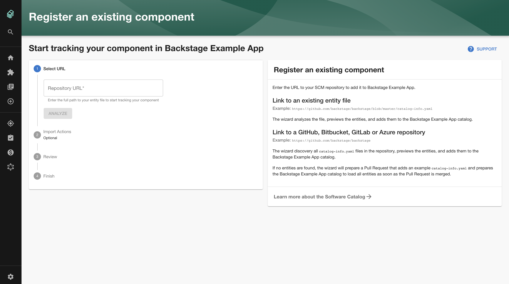

The Catalog Import plugin provides a user interface to register existing `catalog-info.yaml` files into the Software Catalog. It can also analyze Git repositories where no catalog metadata exists and open pull requests to generate component descriptors automatically.



## Features

- **Import from URL**: Register entity descriptor files directly from a URL in any supported Git integration (for example, `https://github.com/backstage/backstage/blob/master/catalog-info.yaml`).
- **Repository discovery** _(GitHub only)_: Search a repository for all existing `catalog-info.yaml` files.
- **Repository analysis and onboarding** _(GitHub only)_: Analyze a repository, generate a component descriptor, and submit a pull request with the new descriptor.

## Installation

Install the plugin in your frontend app package:

```shell
yarn --cwd packages/app add @backstage/plugin-catalog-import
```

Once installed, the plugin is discovered and enabled automatically in the new frontend system. For alternative installation methods, see [installing plugins](../../frontend-system/building-apps/05-installing-plugins.md).

## Configuration

You can configure the target file name and pull request branch name in `app-config.yaml`:

```yaml title="app-config.yaml"
catalog:
  import:
    entityFilename: catalog-info.yaml
    pullRequestBranchName: backstage-integration
```

- `entityFilename`: Name of the entity descriptor file to create (defaults to `catalog-info.yaml`).
- `pullRequestBranchName`: Name of the branch created for onboarding pull requests (defaults to `backstage-integration`).

## Customization

### Custom layout

You can pass a custom layout to `<CatalogImportPage>`:

```tsx
<Route path="/catalog-import" element={<CatalogImportPage />}>
  <Page themeId="home">
    <Header title="Register an existing component" />
    <Content>
      <ContentHeader title="Start tracking your components">
        <SupportButton>
          Start tracking your component in Backstage by adding it to the
          software catalog.
        </SupportButton>
      </ContentHeader>

      <Grid container spacing={2} direction="row-reverse">
        <Grid item xs={12} md={4} lg={6} xl={8}>
          <div>Sidebar guidance or custom instructions</div>
        </Grid>

        <Grid item xs={12} md={8} lg={6} xl={4}>
          <ImportStepper />
        </Grid>
      </Grid>
    </Content>
  </Page>
</Route>
```

### Pull request creation

To customize or disable automatic pull request generation, supply an implementation of `CatalogImportApi` with an overridden `preparePullRequest()` method, or omit the method to disable pull requests entirely.

### Custom example URLs

You can configure custom example entity and repository paths on the form components:

```tsx
<StepInitAnalyzeUrl exampleLocationUrl="https://github.com/example/repo/blob/main/catalog-info.yaml" />
```

```tsx
<ImportInfoCard
  exampleLocationUrl="https://github.com/example/repo/blob/main/catalog-info.yaml"
  exampleRepositoryUrl="https://github.com/example/repo"
/>
```

## Legacy frontend system

If your Backstage application uses the legacy frontend system, register the route manually in `packages/app/src/App.tsx`:

```tsx title="packages/app/src/App.tsx"
import { CatalogImportPage } from '@backstage/plugin-catalog-import';

// Inside your FlatRoutes:
<Route path="/catalog-import" element={<CatalogImportPage />} />;
```
