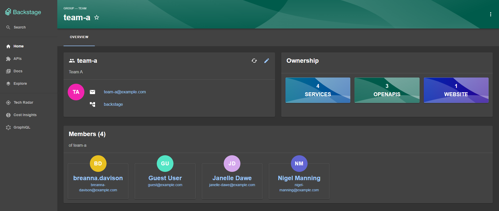
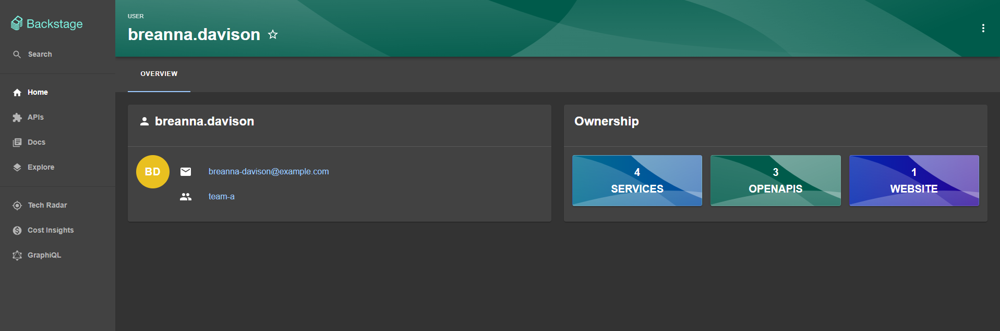
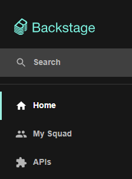
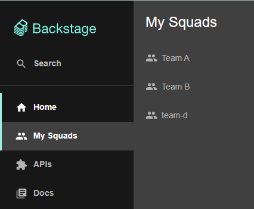

The Org plugin provides views and components for exploring organizational entities in the Software Catalog, including user profiles, group pages, and team membership shortcuts in the sidebar.

## Features

### Group page

The group page displays group details, members, and owned entities:



### User profile

The user profile displays user details, ownership, and group memberships:



## Installation

Install the plugin in your frontend app package:

```shell
yarn --cwd packages/app add @backstage/plugin-org
```

Once installed, the plugin is discovered and enabled automatically in the new frontend system. For alternative installation methods, see [installing plugins](../../frontend-system/building-apps/05-installing-plugins.md).

### Entity cards

You can enable entity cards on catalog entity pages through configuration in `app-config.yaml`:

```yaml title="app-config.yaml"
app:
  extensions:
    - entity-card:org/group-profile
    - entity-card:org/members-list
    - entity-card:org/ownership
    - entity-card:org/user-profile
```

### Custom member avatars

Org plugin surfaces such as `MembersListCard` and `UserProfileCard` render avatars using the shared `UserAvatar` component. By default, avatars use `entity.spec.profile.picture` from the catalog, falling back to initials when that field is empty.

To customize avatar rendering, override `UserAvatar` in your app module:

```tsx
import { createFrontendModule } from '@backstage/frontend-plugin-api';
import { SwappableComponentBlueprint } from '@backstage/plugin-app-react';
import { UserAvatar } from '@backstage/plugin-org';

export const appModuleOrg = createFrontendModule({
  pluginId: 'app',
  extensions: [
    SwappableComponentBlueprint.make({
      name: 'org-user-avatar',
      params: defineParams =>
        defineParams({
          component: UserAvatar,
          loader: () =>
            import('./YourCustomComponent').then(m => m.YourCustomComponent),
        }),
    }),
  ],
});
```

## Legacy frontend system

If your app uses the legacy frontend system, you can manually wire the `MyGroupsSidebarItem` to provide quick access to groups the logged-in user belongs to.

Add the item to `packages/app/src/components/Root/Root.tsx`:

```tsx title="packages/app/src/components/Root/Root.tsx"
import { MyGroupsSidebarItem } from '@backstage/plugin-org';
import GroupIcon from '@material-ui/icons/People';

// Inside your Sidebar:
<MyGroupsSidebarItem
  singularTitle="My Squad"
  pluralTitle="My Squads"
  icon={GroupIcon}
/>;
```

The sidebar item behaves based on user membership:

1. **Not logged in or no group membership**: The item is hidden.
2. **Member of one group**: Displays a single sidebar item:

   

3. **Member of multiple groups**: Displays an item with a sub-menu listing all groups:

   
