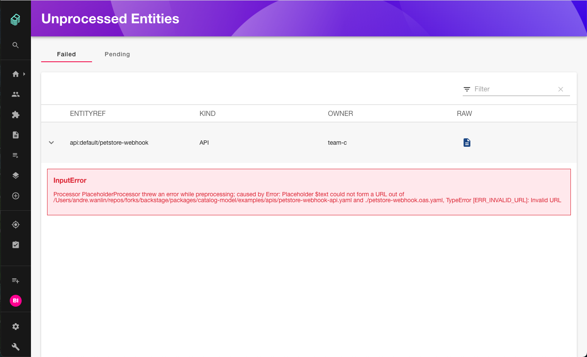
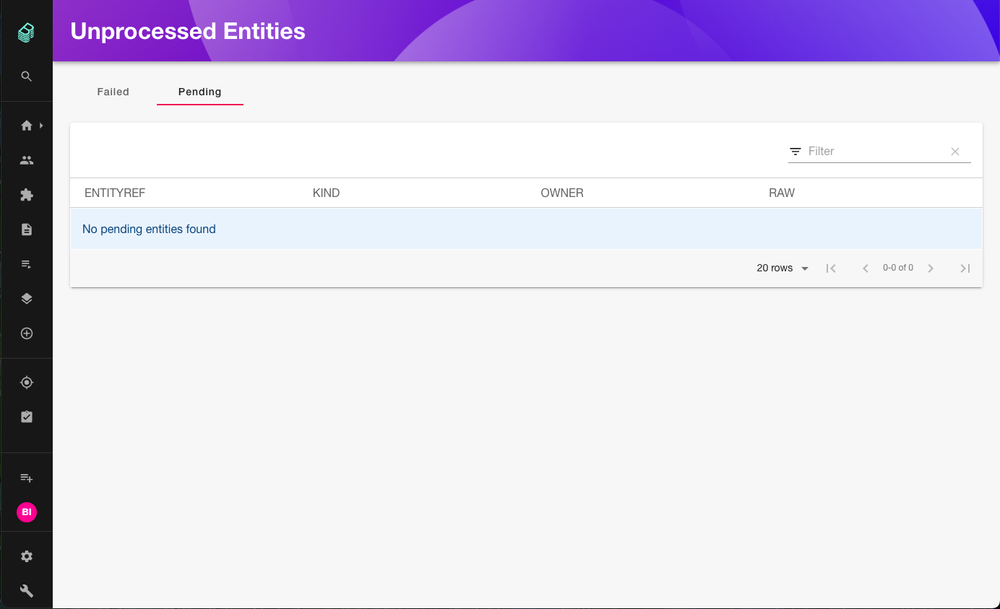
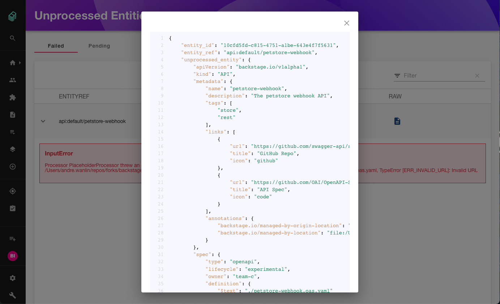

The Unprocessed Entities plugin provides an interface to view and inspect entities that fail processing or remain in a pending state during catalog ingestion.

An unprocessed entity is an entity that does not appear in the catalog. The plugin distinguishes between two entity states:

- **Failed**: The entity has validation or parsing errors that prevent processing.
- **Pending**: The entity is queued or discovered but has not yet finished processing.

## Features

### Failed entities

You can view entities that failed processing, along with error messages and error details:



### Pending entities

You can view entities that are currently pending:



### Raw view

In either the failed or pending tab, you can inspect the raw entity definition as JSON:



## Requirements

The frontend plugin requires the `@backstage/plugin-catalog-backend-module-unprocessed` module to be installed in your backend.

## Installation

### 1. Install backend module

Install the backend module:

```shell
yarn --cwd packages/backend add @backstage/plugin-catalog-backend-module-unprocessed
```

Add the module to your backend in `packages/backend/src/index.ts`:

```ts title="packages/backend/src/index.ts"
backend.add(import('@backstage/plugin-catalog-backend-module-unprocessed'));
```

### 2. Install frontend plugin

Install the frontend plugin:

```shell
yarn --cwd packages/app add @backstage/plugin-catalog-unprocessed-entities
```

The standalone page is disabled by default. To enable the route, add the extension to your `app-config.yaml`:

```yaml
app:
  extensions:
    - page:catalog-unprocessed-entities
```

:::note
If the [DevTools](https://github.com/backstage/backstage/tree/master/plugins/devtools) plugin is installed, unprocessed entities are also available as a tab in DevTools without additional configuration.
:::

## Legacy frontend system

If your app uses the legacy frontend system, register the route manually in `packages/app/src/App.tsx`:

```tsx title="packages/app/src/App.tsx"
import { CatalogUnprocessedEntitiesPage } from '@backstage/plugin-catalog-unprocessed-entities';

// In your AppRoutes or FlatRoutes:
<Route
  path="/catalog-unprocessed-entities"
  element={<CatalogUnprocessedEntitiesPage />}
/>;
```

## Customization

If you need to query unprocessed entities outside the provided page, use the `catalogUnprocessedEntitiesApiRef`:

```ts
import { catalogUnprocessedEntitiesApiRef } from '@backstage/plugin-catalog-unprocessed-entities';
import { useApi } from '@backstage/core-plugin-api';

const catalogUnprocessedEntitiesApi = useApi(catalogUnprocessedEntitiesApiRef);
```

If you use the API without rendering `CatalogUnprocessedEntitiesPage` in the React tree, export the plugin from `packages/app/src/plugins.ts` to ensure the API factory is registered:

```ts title="packages/app/src/plugins.ts"
export { catalogUnprocessedEntitiesPlugin } from '@backstage/plugin-catalog-unprocessed-entities';
```
