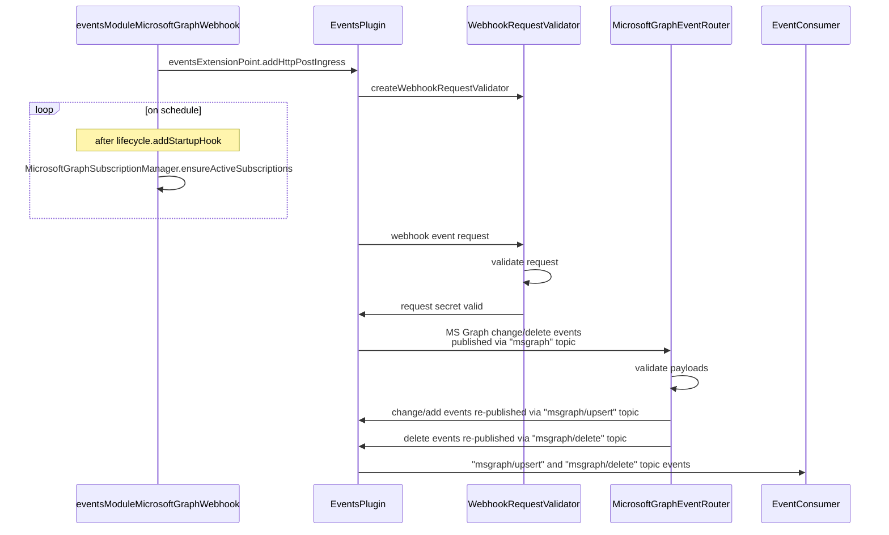
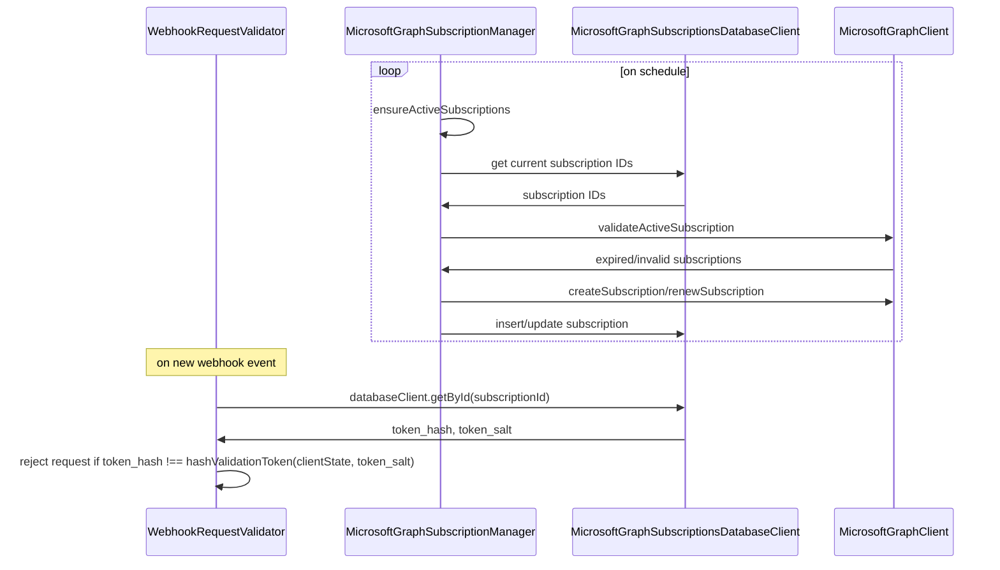

# @backstage/plugin-events-backend-module-msgraph

The Microsoft Graph backend module for the `@backstage/plugin-events-backend` plugin.

This module helps you ingest Microsoft Graph change notifications into Backstage events. It does three things:

- Registers an HTTP ingress for the `msgraph` topic and validates incoming webhook requests.
- Creates and refreshes Microsoft Graph subscriptions for users and groups.
- Subscribes to `msgraph` events and republishes notifications to `msgraph/upsert` or `msgraph/delete`.

## Installation

Install the [`@backstage/plugin-events-backend`](../events-backend/README.md) plugin if you have not done so already.

Then add this module to your backend package:

```bash
# From your Backstage root directory
yarn --cwd packages/backend add @backstage/plugin-events-backend-module-msgraph
```

```ts
// packages/backend/src/index.ts
backend.add(import('@backstage/plugin-events-backend-module-msgraph'));
```

## Configuration

This module uses one set of Microsoft Entra application credentials, and therefore supports one tenant per Backstage
backend. `subscriptionResources` must contain one or both of `users` and `groups`.

Add module configuration in your `app-config.yaml`:

```yaml
events:
  modules:
    msgraph:
      # Public URL that Microsoft Graph can call
      notificationUrl: ${MSGRAPH_NOTIFICATION_URL}

      # Resource types to subscribe to
      subscriptionResources:
        - users
        - groups

      # Entra tenant and app registration credentials
      tenantId: ${MSGRAPH_TENANT_ID}
      clientId: ${MSGRAPH_CLIENT_ID}
      clientSecret: ${MSGRAPH_CLIENT_SECRET}

      # Optional delay before Microsoft Graph subscription scheduling
      startupDelay: 30 seconds
```

`notificationUrl` must be publicly reachable by Microsoft Graph and point to the events backend HTTP ingress for the
`msgraph` topic (for example, `https://backstage-events.example.com/api/events/http/msgraph`). The module automatically
creates and refreshes Graph subscriptions; the application registered with `clientId` must be authorized to manage
subscriptions for the configured resources.

## Published Topics

The webhook ingress publishes validated notifications on `msgraph`. The event router partitions each notification
collection by `changeType` and republishes:

- `msgraph/upsert` for notifications with `changeType: updated` (for users and groups Microsoft Graph reports both creations and updates
  this way).
- `msgraph/delete` for notifications with `changeType: deleted`.

Each published event payload is an array of the matching notification objects, not the original
`ChangeNotificationCollection`. The notification objects are passed through unchanged (with `clientState` secret removed by the validator).
Invalid collections and notifications with other change types are not forwarded.

## How it works

Unlike GitHub webhook events, Microsoft Graph subscriptions must be created through the Graph API. This module
creates subscriptions for the configured resources, handles Graph's endpoint validation request, and periodically
checks and renews subscriptions. The subscription refresh runs immediately after startup (following any configured
`startupDelay`) and then every five minutes. It stores subscription records and salted hashes of the generated
`clientState` tokens in the Backstage database. On notification requests, it validates each notification against the
stored subscription before the events backend publishes the event.

Each refresh also deletes subscriptions for resources no longer listed in `subscriptionResources` from Microsoft
Graph and the database, so their notifications are no longer accepted. If Graph deletion fails, the refresh reports
the error and retries on the next run.



Graph's subscription-validation request is answered with its `validationToken` as plain text. Notification requests are
validated against the subscription's stored `clientState` hash; the `clientState` value is removed from notifications
before they are published to avoid exposing it in logs or otherwise.



Consumers can subscribe to `msgraph/upsert` and `msgraph/delete` and use the notification `resource` to retrieve current
data from Microsoft Graph or handle deletions. This module only routes notifications; it does not update catalog
entities.

## How to test locally

LocalTunnel can be used to receive webhook events in local environments.

1. `brew install localtunnel`
2. `lt --port 7007`
3. Copy the URL printed and add it to your events config:

```yaml
events:
  modules:
    msgraph:
      notificationUrl: https://shaggy-mirrors-admire.loca.lt/api/events/http/msgraph # paste the copied URL here
      subscriptionResources:
        - groups
        - users
      tenantId: <...>
      clientId: <...>
      clientSecret: <...>
```

4. Run with DEBUG log level if you want to see all messages `LOG_LEVEL=DEBUG yarn start backend`
